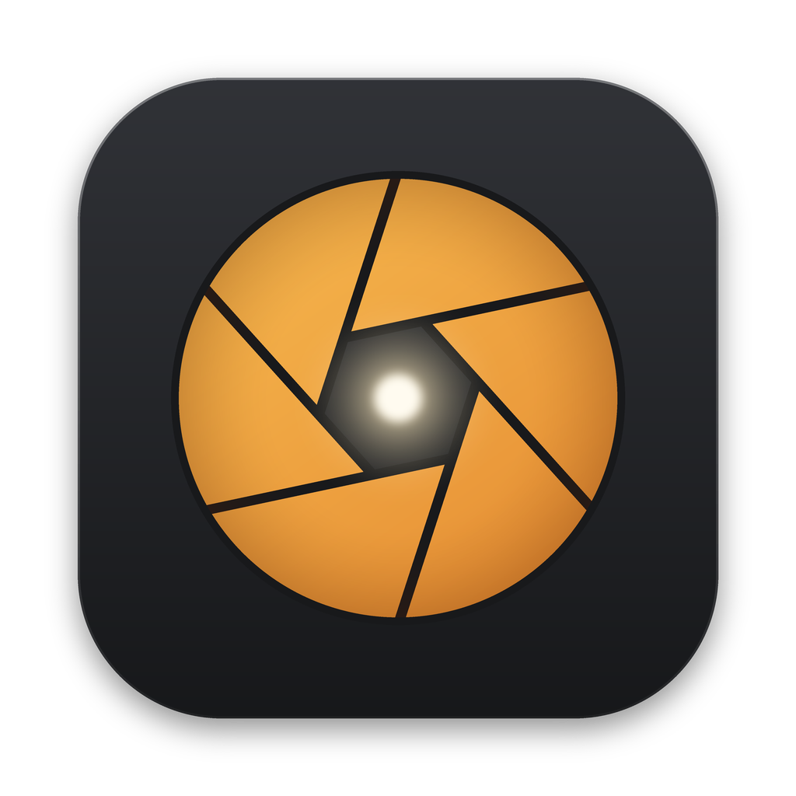
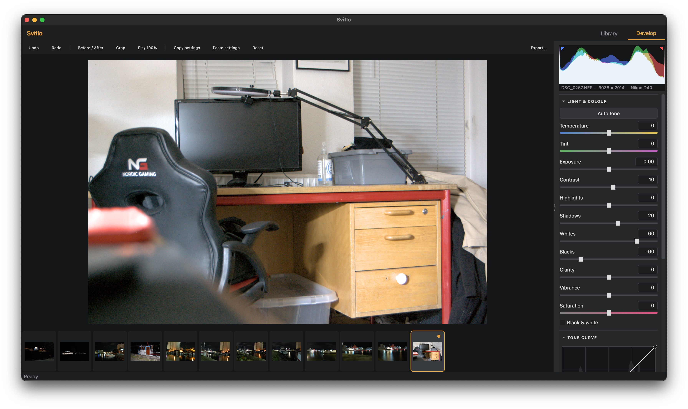

<p align="center">
  
</p>

<h1 align="center">Svitlo</h1>

<p align="center">
  A free, open-source photo library and non-destructive RAW editor.<br>
  Written in C++17 with Qt 6.
</p>
<p align="center">
  <a href="https://github.com/vsavchenko2408/svitlo/actions/workflows/build.yml"></a>
</p>
<p align="center">
  <a href="https://github.com/vsavchenko2408/svitlo/releases/latest"><b>Download for macOS &amp; Windows</b></a> ·
  <a href="README.uk.md">🇺🇦 Українською</a> ·
  <a href="https://ko-fi.com/dermeister">Support on Ko-fi</a>
</p>

<p align="center">
  
</p>

**Svitlo** (Ukrainian for *"light"*) lets you organise your photos and edit them without ever touching the originals. Every edit is stored as a small set of parameters, so you can change your mind at any time.

## Features

**Library**
- Import whole folders (including subfolders) into a fast SQLite catalog
- Star ratings (0–5), pick / reject flags, filters, search by file name or camera
- Thumbnail grid with adjustable size, folder list, multi-selection
- Copy and paste develop settings to many photos at once

**Develop**
- RAW files via LibRaw (NEF, CR2, CR3, ARW, RAF, ORF, RW2, DNG and many more) plus JPEG, PNG and TIFF
- White balance (temperature, tint), exposure, contrast, highlights, shadows, whites, blacks
- Clarity, vibrance, saturation, black & white
- Tone curve with smooth, monotone interpolation
- Crop with aspect ratios, straighten with automatic frame fitting, 90° rotation
- Sharpening and vignette
- RGB histogram with clipping indicators, before / after view, 100% zoom and panning
- Auto tone, full undo / redo history, filmstrip

**Export**
- JPEG (adjustable quality), PNG and TIFF, optional resizing by long edge
- Batch export in the background; existing files are never overwritten

**Non-destructive by design.** Edits live in the catalog and in a small sidecar file next to each photo (`IMG_0001.NEF.svitlo.json`), so they travel with your pictures.

**Languages:** English, Ukrainian, Danish, German and Polish. Svitlo follows your system language; you can change it in **View → Language**.

## Download and install (macOS)

1. Download the latest `.dmg` from [Releases](https://github.com/vsavchenko2408/svitlo/releases/latest).
2. Open it and drag **Svitlo** to **Applications**.
3. Svitlo is not signed with an Apple Developer certificate yet, so macOS will block the first launch. To allow it:
   - try to open Svitlo once, then go to **System Settings → Privacy & Security** and click **Open Anyway**, or
   - run this in Terminal:
     ```bash
     xattr -dr com.apple.quarantine /Applications/Svitlo.app
     ```

**Requirements:** macOS 12 Monterey or later. The current build is for Intel Macs; on Apple Silicon it should run through Rosetta 2 (not tested yet).

## Download and install (Windows)

1. Download `Svitlo-…-windows-x64.zip` from [Releases](https://github.com/vsavchenko2408/svitlo/releases/latest).
2. Unzip it anywhere (for example to `Documents\Svitlo`) and run **Svitlo.exe**. No installation is needed.
3. Svitlo is not code-signed yet, so Windows SmartScreen may warn you on the first start: click **More info → Run anyway**.

**Requirements:** 64-bit Windows 10 or 11.

## Keyboard shortcuts

| Key | Action |
|---|---|
| `G` / `D` | Library / Develop |
| `0`–`5` | Set rating |
| `P` / `X` / `U` | Pick / Reject / Unflag |
| `C` | Crop tool |
| `\` | Before / after |
| `Z` or double-click | Fit / 100% |
| `⌘` + scroll | Smooth zoom |
| `←` / `→` | Previous / next photo |
| `⌘Z` / `⇧⌘Z` | Undo / Redo |
| `⇧⌘C` / `⇧⌘V` | Copy / paste settings |
| `⇧⌘E` | Export |
| `⌘[` / `⌘]` | Rotate 90° |

Double-click a slider's name to reset it.

## Building from source

### macOS

You need Xcode (or the Command Line Tools), CMake and **Qt 6.5** (the *macOS* component from the official Qt Online Installer). Qt 6.5 is used because it still supports macOS 11 and later; newer Qt versions require newer macOS.

LibRaw does not need to be installed: on macOS CMake downloads it and builds it together with the app, using the same minimum macOS version.

```bash
git clone https://github.com/vsavchenko2408/svitlo.git
cd svitlo
cmake -S . -B build -DCMAKE_BUILD_TYPE=Release -DCMAKE_PREFIX_PATH=$HOME/Qt/6.5.3/macos
cmake --build build -j
open build/Svitlo.app
```

Run the core tests with `cd build && ctest --output-on-failure`.

To create a distributable disk image:
```bash
packaging/make-dmg.sh build/Svitlo.app ~/Qt/6.5.3/macos
```

The minimum macOS version is set by `CMAKE_OSX_DEPLOYMENT_TARGET` (default `12.0`).

### Linux (Debian / Ubuntu)

```bash
sudo apt install qt6-base-dev qt6-tools-dev qt6-l10n-tools libqt6sql6-sqlite libraw-dev cmake g++ pkg-config
cmake -S . -B build -DCMAKE_BUILD_TYPE=Release
cmake --build build -j
./build/Svitlo
```

### Windows

You need Visual Studio 2022 (with *Desktop development with C++*), CMake and Qt 6.8 for MSVC 2022 64-bit. LibRaw is downloaded and built automatically.

```powershell
cmake -S . -B build -G "Visual Studio 17 2022" -A x64 -DCMAKE_PREFIX_PATH=C:\Qt\6.8.3\msvc2022_64
cmake --build build --config Release
packaging\make-windows-zip.ps1 -Exe build\Release\Svitlo.exe -QtDir C:\Qt\6.8.3\msvc2022_64
```

## Architecture

```
src/
  core/       image pipeline without any widget code (also used by the tests)
    ImageLoader   RAW (LibRaw, linear 16-bit) and common formats → float RGB
    Pipeline      geometry → white balance / exposure → clarity → tone → colour
                  → vignette → gamut soft-clip → sharpening → 8-bit sRGB
    ToneCurve     Fritsch–Carlson monotone spline
    Geometry      rotation, straightening, crop fitting
    EditSettings  edit parameters + JSON serialisation
    Exporter      full-resolution batch export
  catalog/    SQLite catalog, asynchronous thumbnail cache
  ui/         Qt Widgets: library, develop view, panels, tone curve, histogram, crop
tests/        core tests (run without a display)
translations/ interface translations
```

Some design decisions:
- **Float processing in linear light.** Exposure and white balance are applied as gains in linear space; tone adjustments work on luminance and scale RGB proportionally, so hues don't shift.
- **Responsive previews.** The preview is limited to 2560 px and rendered on a background thread. While a render is running, newer slider changes are coalesced into the next render.
- **Preview matches export.** Sharpening radii are scaled to the preview resolution, and clarity uses a radius relative to the image size.
- **Multithreading** with `QtConcurrent` over image rows.

## Translations

Translations live in `translations/*.ts`. After changing interface strings:
```bash
cmake --build build --target update_translations   # update the .ts files
python3 translations/fill_translations.py          # fill them from the table in the script
```

## Roadmap

- HSL colour mixer and split toning
- Local adjustments (graduated filter, brush)
- Lens correction (lensfun) and noise reduction
- Full-resolution 100% view, EXIF copying on export
- Presets, virtual copies, collections
- Linux packages, Apple Silicon build, Windows installer

## Support

Svitlo is free and made in my spare time. If you find it useful, you can support its development on [Ko-fi](https://ko-fi.com/dermeister) or with Bitcoin (address in **Help → Support Svitlo**). Bug reports and ideas are very welcome in [Issues](https://github.com/vsavchenko2408/svitlo/issues).

## License

Svitlo is released under the [MIT License](LICENSE).

It uses [Qt 6](https://www.qt.io) under the LGPL v3 (linked dynamically) and [LibRaw](https://github.com/LibRaw/LibRaw) under the CDDL 1.0 (LibRaw is dual-licensed LGPL 2.1 / CDDL 1.0). Full notices are in **Help → Licenses**.

Svitlo is an independent project and is not affiliated with any commercial photo software vendor.

---

<p align="center">Made in Ukraine 🇺🇦</p>
